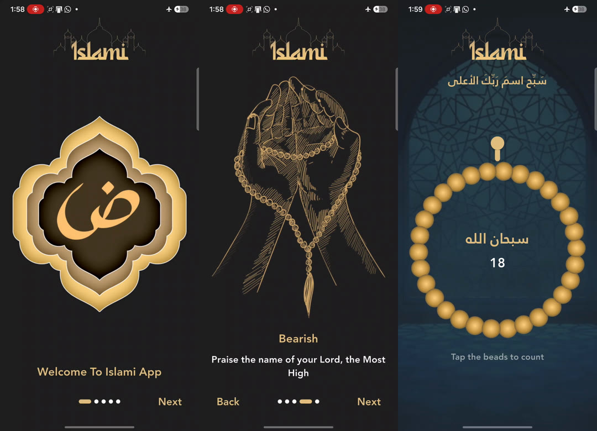

# Islami App: Onboarding and Sebha

A Flutter app with an onboarding flow and a digital sebha (prayer beads counter), built from a Figma design.
Swipe through five welcome slides, then tap the beads to count your dhikr.

Practice project from the Route Mobile Diploma. It is a UI exercise with no backend and no saved data.

<p align="center">
  
</p>

## Screens

| Screen | What it does |
|--------|--------------|
| **Onboarding** | Five slides in a `PageView`, each with an illustration, a title and a subtitle. A gold logo stays on top, an expanding-dots indicator shows the position, and Back and Next buttons move between slides. The first slide has no Back, and the last slide shows Finish instead of Next, which opens the sebha and cannot be navigated back from |
| **Sebha** | A fixed header and a ring of beads. Every tap adds 1 to the counter and turns the ring by one bead. At 33 the counter resets and the phrase changes, cycling through *سبحان الله*, *الحمد لله* and *الله أكبر* |

### How the sebha works

- The header is outside the rotating part, so it stays still while the beads turn.
- The ring is turned with `AnimatedRotation`, one bead (1/33 of a turn) per tap. The rotation is never reset,
  so the ring keeps turning in the same direction instead of snapping backwards when the counter resets.
- The ring size is calculated from the available height with `LayoutBuilder`, so it adapts to the screen.

### How the onboarding works

- The five slides are described as data in `onboarding_page_data.dart`, and the screen loops over the list.
  Adding a slide is one entry in that list.
- `SmoothPageIndicator` (with `ExpandingDotsEffect`) shares the same `PageController` as the `PageView`,
  so the dots follow both swipes and button taps.
- Back, Next and Finish are the same `OnboardingTextButton` widget with a different label and action.

## Design tokens

| Token | Value |
|-------|-------|
| Gold | `#E2BE7F` |
| Black (background) | `#202020` |
| White | `#FFFFFF` |

## Project structure

One widget per file, and the screens only wire the widgets together.

```
islami_app/
├── lib/
│   ├── main.dart
│   ├── common/        # colors, text styles, asset paths, theme
│   ├── models/        # onboarding slides data, dhikr phrases and target
│   ├── screens/       # onboarding and sebha
│   └── widgets/       # header, onboarding slide, text button, sebha header, beads ring, counter
├── assets/images/     # illustrations, backgrounds and the beads ring
├── screenshots/       # screenshot used in this README
├── pubspec.yaml
└── NOTES.ar.md        # my study notes (Arabic)
```

## Getting started

This folder contains only the Dart code and assets, so generate the platform folders first:

```bash
cd islami_app
flutter create .
flutter pub get
flutter run
```

`flutter create .` may add a default `test/widget_test.dart` that targets the counter template.
Delete or adapt it, because this app has no counter.

Requires Flutter with Dart 3.0 or newer. Depends on
[`smooth_page_indicator`](https://pub.dev/packages/smooth_page_indicator).

## Assets

- The illustrations, backgrounds and the beads image come from the course's Figma file and are included here
  only so the project runs as a learning exercise. They belong to their respective owners and are not
  covered by any license for this repository. They were resized to at most 900 px, because full-size images
  can run a phone out of memory.
- **Font.** The design uses the *Janna LT Bold* Arabic font, which is **not included** because its license is
  unclear. Without it, the app uses the default font. To use it, put the file in `assets/fonts/` and
  uncomment the `fonts:` block at the end of `pubspec.yaml`. The theme already asks for the `Janna LT` family.

## Widgets and concepts practiced

`MaterialApp` with named routes and `pushReplacementNamed`, `PageView.builder` with `PageController`
(`nextPage`, `previousPage`, `onPageChanged`), `AnimatedRotation`, `LayoutBuilder`, `Stack`, `GestureDetector`,
`TextButton.styleFrom`, `StatefulWidget` with `setState` and `dispose`, `ThemeData` with a custom font family,
collection-if, `static const` classes, reusable widgets with `required` parameters, and the
`smooth_page_indicator` package.
